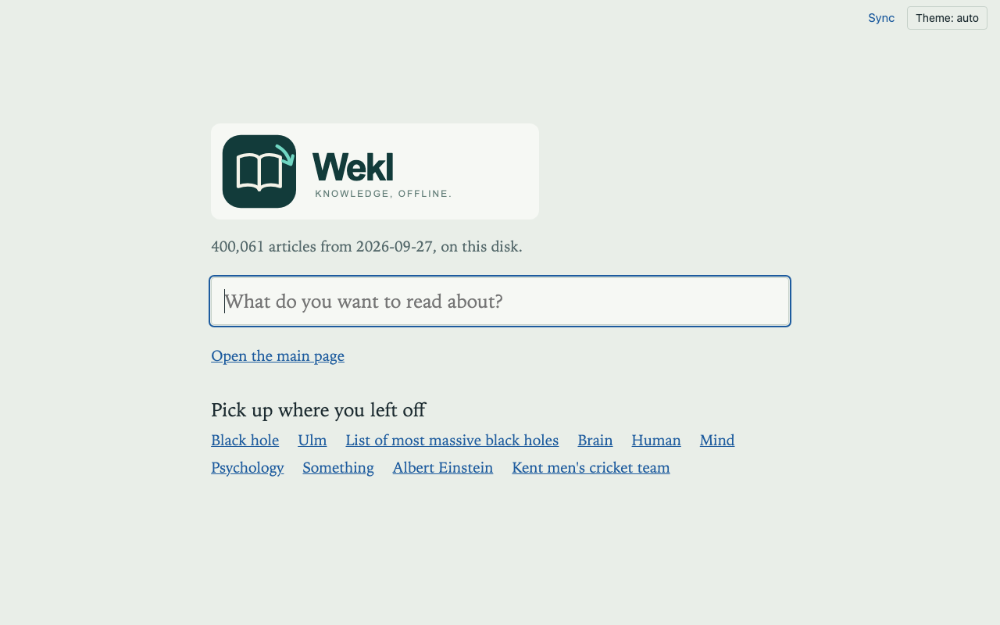
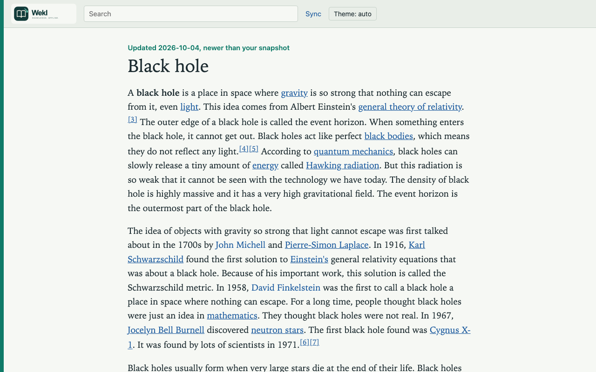
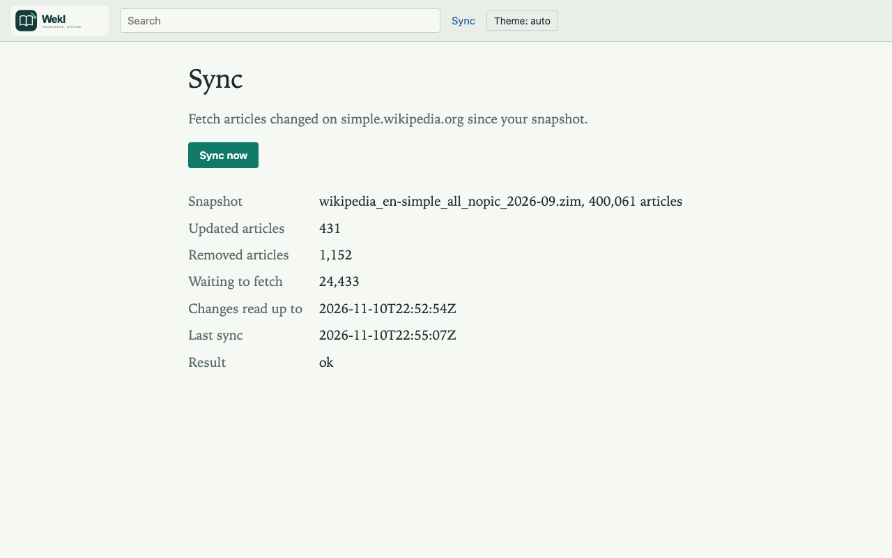

<p align="center">
  
</p>

<p align="center">
  <strong>Wikipedia that travels with you.</strong>
  <br>
  Read offline. Catch up online.
</p>

<p align="center">
  
  
  
  <a href="https://github.com/aymane-amounas/WekI/actions/workflows/ci.yml"></a>
</p>

WekI is an offline Wikipedia reader that keeps your local copy from going stale.

The idea is simple. You download a Kiwix ZIM archive once, which is a full snapshot of Wikipedia in one file, and read it with no network. The snapshot ages the moment you make it, so WekI keeps a small SQLite database next to it and pulls in newer articles and changes whenever you're back online. You read from the snapshot anywhere; the database fills in what changed since.

## At a glance

| Name | What it does | Stack | Demo |
|---|---|---|---|
| **WekI** | Offline Wikipedia reader that syncs newer articles when you're back online | Python · SQLite · libzim | [Screenshots](#screenshots) · [Live-sync report](benchmarks/live-sync-2026-11-10.md) · [Quickstart](#get-started) |

There's no hosted link, and there won't be. WekI runs on your machine for one person, against your own archive, so a public demo wouldn't mean much. The closest thing to a demo is the [Get started](#get-started) quickstart. For recorded evidence that it works, see the [screenshots](#screenshots) and the [live-sync report](benchmarks/live-sync-2026-11-10.md).

## Screenshots

<table>
  <tr>
    <td></td>
    <td></td>
  </tr>
  <tr>
    <td align="center"><sub>Home: 400,061 Simple English articles on disk</sub></td>
    <td align="center"><sub>An article synced newer than the ZIM snapshot</sub></td>
  </tr>
  <tr>
    <td colspan="2" align="center"></td>
  </tr>
  <tr>
    <td colspan="2" align="center"><sub>Sync status: updated, removed, and queued articles with cursor and last result</sub></td>
  </tr>
</table>

## Why I built it

I wanted Wikipedia I could read without a connection, but I didn't want it frozen at the day I downloaded it. Existing offline readers give you the snapshot and stop there. So WekI adds the part that was missing: read the whole thing offline, and when you do get online, let it quietly catch up on what changed instead of making you re-download everything.

A few things fall out of that:

- You can read your local Wikipedia with no internet at all.
- When you're online, it fetches newer articles and the edits, redirects, and deletions that happened since your snapshot.
- Those updates live in a separate database, so your original archive is never touched.
- If a sync gets interrupted, the unfinished work stays queued and picks up next time.
- Search runs locally across both the archive and the newer articles.

One honest caveat up front: this is an experimental single-user app, and Simple English Wikipedia is the target that actually works today. Full English Wikipedia is too big to keep current through the public API, and I haven't solved that yet. More on that in [Current limitations](#current-limitations).

## Get started

### Requirements

- Python 3.11+
- [uv](https://docs.astral.sh/uv/)
- About 1 GB of free disk space for the Simple English archive, plus room for the database on top. The first archive download and the first sync each take a few minutes on a normal connection.

### Install

```bash
git clone https://github.com/aymane-amounas/WekI.git
cd WekI

uv sync --locked
uv run --locked python scripts/download_zim.py
uv run --locked python run.py
```

Then open **http://127.0.0.1:8787** in your browser.

The archive reads fine on its own, no sync required. When you have a connection, hit **Sync → Sync now** to pull in newer content.

If you started WekI before the ZIM download finished, restart it so it finds the archive. To use a different port, run `uv run --locked python run.py --port <port>`.

## How it works

WekI reads from two places:

```text
       Wikipedia ZIM
       (Read-only)
            |
            v
      Article Reader
            ^
            |
       SQLite Overlay
       (Newer changes)
            ^
            |
      Wikimedia API
       (When online)
```

The ZIM archive is the original snapshot and never changes. SQLite holds everything that happened after it: newer articles, redirects, deletions, the search index, and how far sync has gotten.

When you open an article, WekI looks at the newer content first, then at deletion records and redirects, and only then falls back to the original archive. So you always see the freshest version it has.

During a sync, every change it discovers goes into a persistent queue. It fetches them a batch at a time and keeps whatever it didn't finish for the next run, so nothing gets lost if you close the laptop halfway through.

## Measured results

These were measured on macOS (Apple Silicon). The method, iteration counts, and the caveats that go with them are in [`docs/benchmarks.md`](docs/benchmarks.md); the raw reports and the commands to reproduce them are in [`benchmarks/`](benchmarks/).

| What | Result | Report |
|---|---:|---|
| Real ZIM article lookup, p50 / p95 | 0.002 / 0.013 ms | [real-zim-openzim](benchmarks/real-zim-openzim.md) |
| Real ZIM full-text search, p50 / p95 | 1.40 / 1.64 ms | [real-zim-openzim](benchmarks/real-zim-openzim.md) |
| Overlay upsert with FTS, 100k articles | 68,151 articles/s | [overlay-macos-arm64](benchmarks/overlay-macos-arm64.md) |
| Updated-article search, p50 / p95 | 0.42 / 0.48 ms | [overlay-macos-arm64](benchmarks/overlay-macos-arm64.md) |
| Peak memory (overlay benchmark) | 37.7 MiB | [overlay-macos-arm64](benchmarks/overlay-macos-arm64.md) |
| Live sync against simple.wikipedia.org | initial + incremental runs, 0 failed fetches, integrity `ok` | [live-sync-2026-11-10](benchmarks/live-sync-2026-11-10.md) |

Read the live-sync numbers loosely: that test is a short-window smoke test to prove the request path works against the real service, not a throughput benchmark. The 197-test suite runs entirely on local fixtures and mocked network responses.

## For developers

It's Python, SQLite, and [libzim](https://github.com/kiwix/libzim), nothing exotic. The pieces:

- **Reader** resolves an article across the ZIM and the SQLite overlay.
- **Storage** keeps the ZIM read-only and puts every update in SQLite.
- **Search** combines archive search with overlay search.
- **Sync worker** reads Wikimedia revision and page-log events, fetches the article content, and keeps a persistent cursor and backlog.
- **Recovery** leans on SQLite transactions so article updates, backlog changes, and cursor progress stay consistent together.
- **Networking** sends a bot User-Agent, caps concurrency, respects `maxlag`, and backs off on retries.

If you want the reasoning rather than the layout, read [`docs/architecture.md`](docs/architecture.md), the decision records in [`docs/adr/`](docs/adr/), and [`docs/recovery.md`](docs/recovery.md) for how an interrupted sync stays consistent.

### Development setup

```bash
uv sync --locked --all-groups

uv run --locked pytest
uv run --locked ruff check .
uv run --locked ruff format --check .
```

The tests use local fixtures and mocked network responses. The real-archive and live-sync tests are documented separately under `benchmarks/`.

## Data and backups

WekI never writes to your ZIM archive.

What's worth backing up is the SQLite overlay:

```bash
uv run --locked python scripts/backup_overlay.py backups/overlay.db
```

Keep the matching ZIM archive and `config.toml` alongside it. A database backup on its own is not a full backup of your library, since it's useless without the archive it was built against.

For how to restore and what consistency you actually get, see [`docs/recovery.md`](docs/recovery.md). What's known about storage and filesystem limits is in [`benchmarks/filesystem-compatibility.md`](benchmarks/filesystem-compatibility.md).

## Current limitations

WekI is early, and some of this is still open:

- Keeping full English Wikipedia current at scale isn't solved. The public API is too slow to catch up on that volume, so for now full English only keeps the pages you actually read fresh.
- Removable-drive reliability and exFAT, NTFS, and ext4 compatibility aren't certified. I've tested on macOS/APFS; the rest is unverified.
- AI search, image sync, packaging, and multilingual support aren't built yet.

The [benchmark reports](benchmarks/) have the actual test results and what the compatibility evidence does and doesn't cover.

## Contributing

Found a bug or have an idea?

- [Open an issue](https://github.com/aymane-amounas/WekI/issues)
- [Explore the source](https://github.com/aymane-amounas/WekI)

Pull requests and thoughtful feedback are both welcome.

## License

WekI's code is under **GPL-3.0-or-later**.

Wikipedia content comes with its own licensing, including **CC BY-SA 4.0** attribution and share-alike terms.

---

<sub>Built by [lethebyte](https://github.com/aymane-amounas)</sub>
